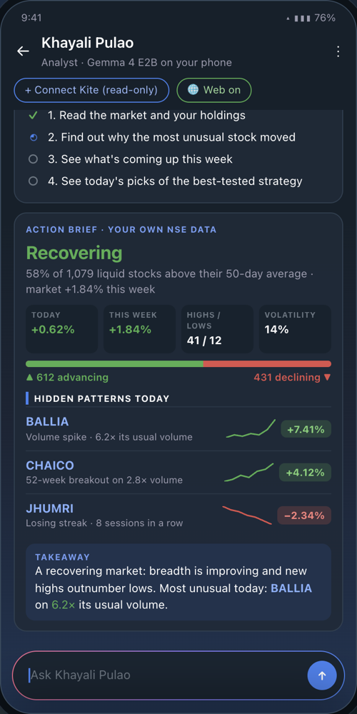
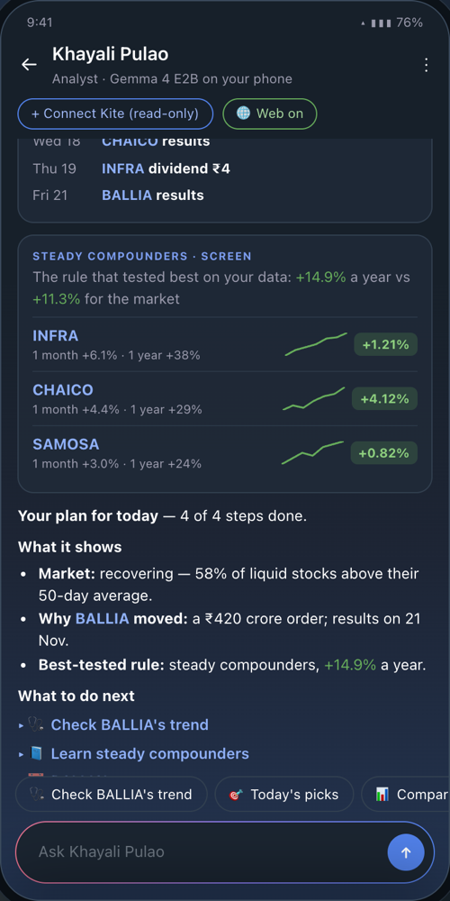
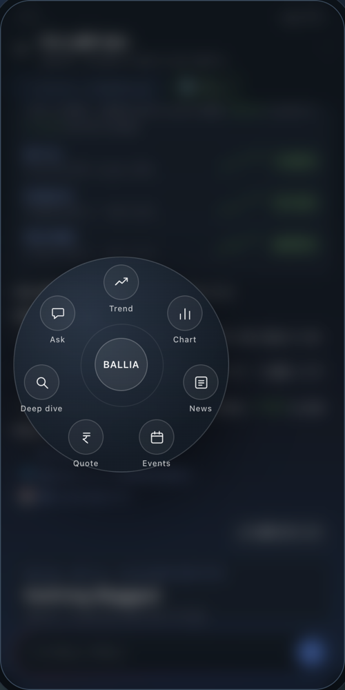
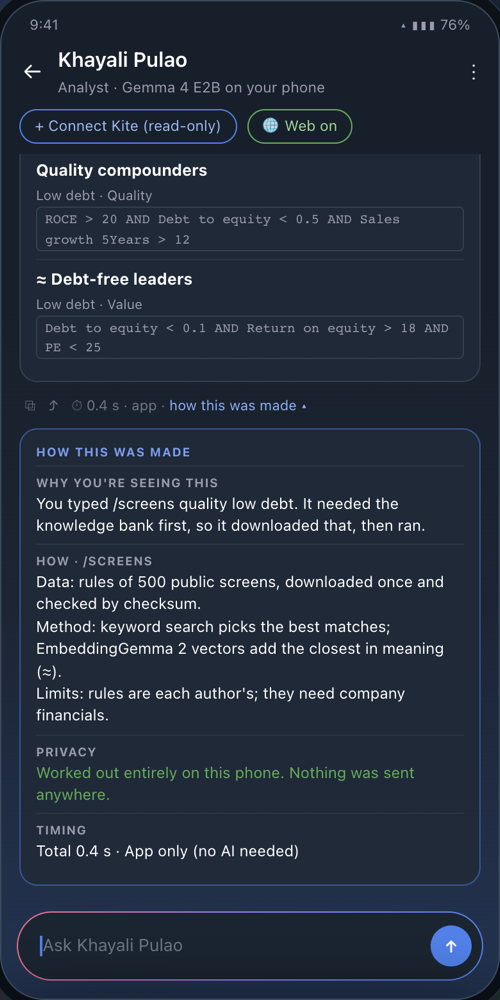
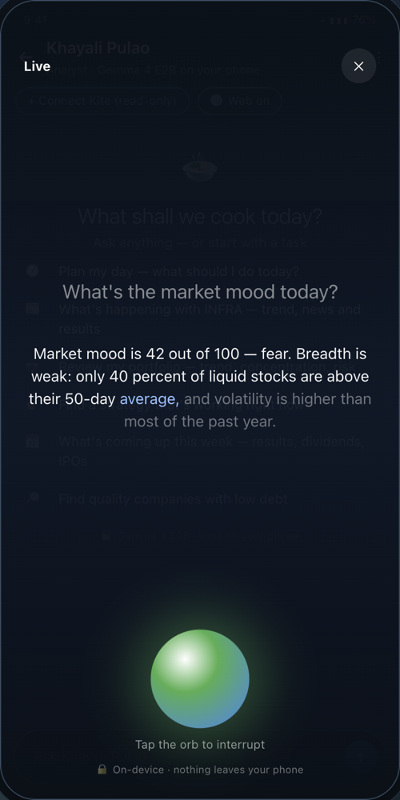
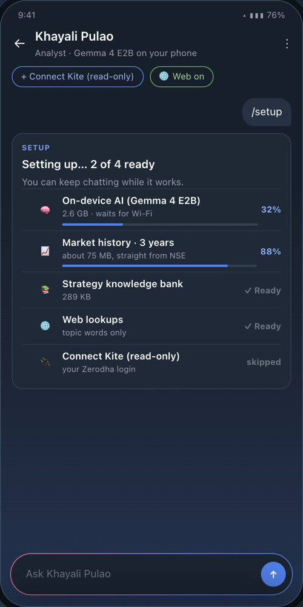
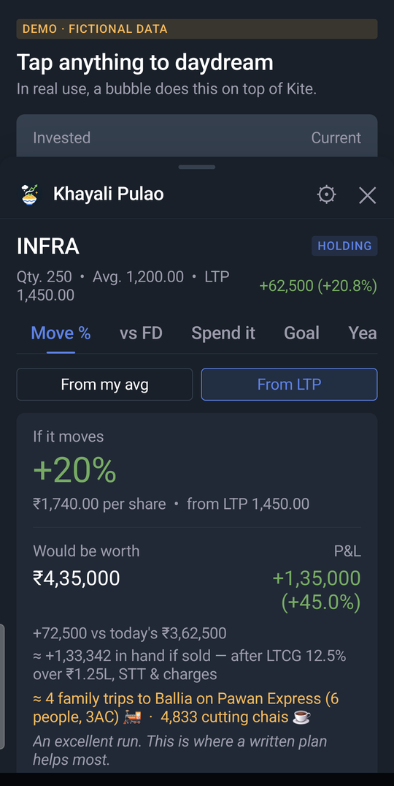
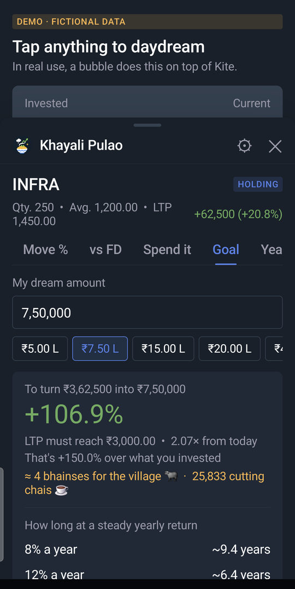

<p align="center">
  
</p>

<h1 align="center">Khayali Pulao</h1>

<p align="center">
  <b>Your private market advisor. Nothing leaves your phone.</b><br>
  Ask in plain words. It makes a plan, runs every step on your phone with your own copy of NSE's market data, and hands you next steps you can tap.<br>
  The AI runs on the phone too — no account, no server, no analytics.
</p>

<p align="center">
  <a href="https://github.com/iprajax/khayali-pulao/actions/workflows/ci.yml"></a>
  
  
  
  
  <a href="LICENSE"></a>
</p>

<p align="center">
  <a href="https://iprajax.github.io/khayali-pulao/">Website</a> ·
  <a href="https://github.com/iprajax/khayali-pulao/releases/latest">Download APK</a> ·
  <a href="#-nothing-leaves-your-phone">Privacy</a> ·
  <a href="CHANGELOG.md">What's new</a>
</p>

<table>
  <tr>
    <td></td>
    <td></td>
    <td></td>
    <td></td>
  </tr>
  <tr>
    <td align="center"><sub>Plans your day</sub></td><td align="center"><sub>Next steps you can tap</sub></td>
    <td align="center"><sub>Every stock is a wheel</sub></td><td align="center"><sub>Explains itself</sub></td>
  </tr>
</table>
<p align="center"><sub>Rendered from the website's replay of the chat — fictional stocks and data.</sub></p>

## Why it exists

Money apps want your portfolio on their servers. AI assistants want your questions in their cloud. For something as personal as your money, Khayali Pulao takes the opposite route: **the AI, your data and every calculation stay on your phone.** There is no Khayali Pulao server, so there is nothing to sign up for and nowhere for your data to go.

It is also built to be *useful*, not just private: ask "what should I do today?" and it doesn't do one lookup — it plans, runs each step, shows its working, and ends with what to look at next. It shows what the data and each rule say. It never tells you to buy or sell.

> **ख़याली पुलाव (khayali pulao)** — *"imaginary pulao"*, rice you cook only in your head: Hindi for daydreaming. Every investor does it — this app does the maths properly.

## 🔒 Nothing leaves your phone

- **Your voice stays on the phone.** Live voice uses Android's on-device speech recognizer only; the app never receives or keeps your audio, and there is no cloud fallback. The microphone is asked for only when you first tap 🎤.
- **The AI runs on the phone.** Gemma 4 E2B (Google LiteRT-LM), downloaded once and checked by SHA-256. Your questions and its answers are never sent to a cloud AI.
- **Your data stays on the phone.** Kite holdings are matched on the phone. Your NSE history, analysis, backtests, chat and memory live in private app storage — excluded from cloud backup and phone-to-phone transfer.
- **No analytics, no audit trail.** No analytics, crash reporting, ads or third-party SDKs. No account, no login. The app keeps no logs anywhere but your phone, and you can wipe everything (⋮ → Models & data, Memory → Erase, New chat).
- **Reads, never trades.** The Kite connection is read-only; order tools are blocked in code and tests.

**The only times it touches the internet — each one switched on by you:**

| When | Goes to | What is sent |
|---|---|---|
| AI model download, once | Hugging Face | The file request |
| Market history, when you ask | NSE's public archive | A request for each day's file |
| Knowledge bank, when you ask | This project's website | The file request |
| Connect Kite (optional) | Zerodha's official [Kite MCP](https://github.com/zerodha/kite-mcp-server) | Read-only calls; you log in on Zerodha's own page |
| Web lookups (opt-in) | DuckDuckGo, Yahoo Finance, NSE, Moneycontrol, InvestorGain | Topic words or a symbol — amounts, quantities and IDs are stripped first |
| News and SEBI (with Web on) | Economic Times, Mint, Business Standard, BusinessLine, CNBC-TV18, SEBI | A request for each public feed — nothing about you |

**Never sent, to anyone:** your holdings, amounts, questions, voice, chat or memory. The app has no server and keeps no logs; the sites above see an ordinary request, as from any browser.

**How you can check it:** the app asks for three permissions: Internet; the microphone, for live voice; and notifications, for price alerts — the last two only when you first use them. All networking lives in two files, and CI fails the build if networking code appears anywhere else or an unlisted host is used ([`OnDeviceOnlyTest`](app/src/test/kotlin/com/khayali/pulao/OnDeviceOnlyTest.kt)). Every reply's **How this was made** panel says what, if anything, was sent. Details: [PRIVACY.md](PRIVACY.md) · [SECURITY.md](SECURITY.md).

## What it does for you

### 💬 A chat that feels like the best assistants
A side drawer holds your chats — search them, pin, rename or delete with a long-press. **+** opens one sheet of tools; the mic dictates into the box; while a reply runs, send turns into **stop**. Each answer shows the steps it's taking, then folds them into one line, and ends with 👍 / 👎, 🔊 read aloud and ⋮ for shorter, longer or simpler. Every chat stays on the phone.

### 🎤 Talk to it
Tap Live and just talk — right inside the chat. What you say becomes your message, the answer appears with its cards and is read back sentence by sentence with each word lit as it's spoken. Talk over it or tap the orb to interrupt; mute or End any time. It all happens on the phone: speech is recognised by Android's on-device recognizer (never a cloud one), answers use an offline voice, and what you say goes through the same chat — so every command, plan and card works by voice.

<p align="center"></p>

### ❓ Why is it moving? News, filings and SEBI
- `/why INFY` splits a move into market, sector and the stock's own part, then ranks the evidence — unusual volume, a big move for this stock, 52-week levels, filings and news.
- `/news` reads five outlets (Economic Times, Mint, Business Standard, BusinessLine, CNBC-TV18), folds them into one story per event, tags the tone and links each to the stocks it names. Buy/sell tips are never relayed.
- `/radar` sorts two days of NSE filings by what matters, your stocks first; `/sebi` shows the regulator's latest circulars, orders and press releases.
- `/mood` is a 0–100 fear-greed gauge from your own data; `/pulse` puts mood, breadth, sectors, hidden patterns and headlines on one screen.

### 🗺 Plans your day — and ends with what to do next
Ask **"What should I do today?"** and it becomes a plan: the market's trend and hidden patterns from your own NSE data, the news behind the most unusual stock it found, the week's results and dividends, and today's picks of the strategy that tested best — each step's card in turn, ticking off as it goes. It ends with what it all shows and **next steps you can tap**. The same works for one stock (*"should I buy INFY?"*), your portfolio, why the market moved, which strategy to follow, or an IPO.

### 🧭 Your own market data, analysed on the phone
`/data 3y` downloads three years of NSE's daily prices straight from NSE's archive (about 25 MB a year — every phone fetches its own copy; nothing is redistributed). Then:

| Command | What it does |
|---|---|
| `/brief` | The action brief: market regime, the week, hidden patterns, your holdings, strategy signals, next steps |
| `/regime` | Breadth, trend, new highs/lows, volatility |
| `/anomalies` | Hidden patterns: volume spikes, outsized moves, streaks, breakouts — each against the stock's own history |
| `/strategies` | 14 rules backtested side by side on your data, from one start date |
| `/screen momentum` | One rule's picks today, with its backtest |
| `/health INFY` | One stock's (or your holdings') trend and risk |
| `/learn` | The playbook: 25 strategies — 14 that run on your data, 11 fundamental families with the thresholds most used across 500 public stock screens |
| `/screens quality low debt` | Search those 500 community screens by idea (a 289 KB knowledge bank with EmbeddingGemma 2 vectors) |
| `/sectorboard 1w` | All 18 NSE sector indices: 1D to 5Y returns, CAGR and P/E, sorted by any period or date range — tap one to open it |
| `/sector bank 1m` | One sector: every period and CAGR, valuation, a year against the Nifty 50, and its gainers and losers |
| `/pulse` | The market on one screen: mood, breadth, sectors, hidden patterns, headlines |
| `/mood` | Market mood index, 0–100 fear to greed, from six parts of your own data |
| `/why INFY` | Why a stock moved: market, sector and its own part, then the evidence |
| `/news` · `/news INFY` | Market news from five outlets, one story per event, tone-tagged and linked to tickers |
| `/radar` · `/radar mine` | Two days of exchange filings sorted by what matters, your stocks first |
| `/sebi` | SEBI's latest circulars, orders, press releases and consultation papers |
| `/find oversold above 200 day` | A screener in plain words over every liquid stock in your history |
| `/alert INFY above 1800` | Price alerts checked on the phone after each close, with a notification — even with the app closed |
| `/redflags` | Your stocks on NSE's surveillance lists (ASM, GSM, ESM) |
| `/healthscore` | Portfolio health 0–100: diversification, concentration, beta, volatility, drawdown, vs Nifty |
| `/harvest 80000` | Tax-loss harvesting: losses that could offset gains you've booked, and the tax it could save |
| `/positioning` | FII, DII, Pro and Client positioning in index futures and options |
| `/concall INFY` | A company's earnings-call transcripts, audio and analyst-meet filings |

Sector levels are NSE's **official index closes** (from NSE's daily index file) and members come from **NSE Indices'** published lists — both fetched by your phone with the market history.

### ⚡ Set up in one tap
Type `/setup` (or tap the first starter): pick the AI model, three years of market history, the knowledge bank, web lookups and Kite, then **Set up everything** — downloads run in parallel with live status, web switches on, and Kite waits for your login on Zerodha's page. The status survives restarts.

<p align="center"></p>

### 👆 Everything is tappable
Every suggested next step, every command mentioned in an answer and every **ticker** — tap or long-press a stock and its actions fan out on a **wheel** around your finger: trend and risk, chart, news, results and dividends, quote, a deep-dive plan, or ask about it. Tap a command and it **asks for each parameter** with choices to pick. An empty chat opens with task starters built around your own stocks.

### 🔍 Every answer explains itself
Under each reply, **How this was made**: why you're seeing it (you typed it, a plan step, a tapped suggestion, or the AI's choice), which data made it and how fresh it is, the exact method and parameters, its limits, the timing — and a privacy line saying what, if anything, left the phone.

### 💼 Your portfolio, read-only
**Connect Kite** (optional) and it reads your holdings, positions, margins and orders through Zerodha's official Kite MCP — reviewing each holding's trend, concentration and risk. The original **daydream sheet** still floats on Kite: tap a holding to see what it's worth at +5%, +15% or 2×, whether you beat an FD, and what the profit buys in hand after tax.

### 📟 96 commands, and opt-in web
A market terminal in the chat — indices, sectors, movers, breadth, option chain, technicals, results as a money-flow, shareholding, global markets, mutual funds and planners. With **Web** on: the week's calendar, IPOs and grey-market premium, and news with numbered sources (figures not found in a source are removed).

<details>
<summary><b>All 96 commands</b></summary>

<!-- terminal-commands -->

Chart cards built from public, no-login data: NSE's own feeds and exchange filings, public price feeds, World Bank and mfapi.in open data. Web access is opt-in; the calculators and portfolio views marked *works offline* never touch the network. Your holdings are matched on the phone and never sent. Type `/` in the chat to browse, or just ask — short questions like "show me the heatmap" run the matching card directly, and the AI can call any of them.

**Market** (15)

| Command | What you get |
|---|---|
| `/report` | Market report: indices, breadth, sectors, top gainers and losers, FII/DII flows, your stocks — one card |
| `/sectormovers` | Sector-wise top gainers and losers: each sector's move with its best and worst stocks |
| `/preopen` | Pre-open session: indicative opening prices, gap-ups and gap-downs in F&O stocks |
| `/heatmap NIFTY BANK` | Index heatmap: every constituent sized by traded value, coloured by today's move |
| `/indices sectoral` | NSE indices ranked by today's move (broad, sectoral, thematic, strategy), with P/E and 52-week position |
| `/sectors` | Sector indices ranked by today's move, with 30-day and 1-year change (/sectors 30d or 1y to rank by those) |
| `/movers fno` | Top gainers and losers today — NIFTY 50 by default, or bank, next50, fno, all |
| `/breadth` | Market breadth: how many NSE stocks are up, down and unchanged today, and the advance/decline ratio |
| `/active` | Most active securities today: by traded value (₹ crore) and by number of shares |
| `/status` | Is the market open? Each NSE segment's state, plus the previous session's turnover by segment |
| `/highs` | Stocks that set a new 52-week high or low today, with the count on each side |
| `/bands` | Stocks that hit their upper or lower price band (circuit limit) today |
| `/volume` | Unusual volume: stocks trading at several times their 1-week average volume today |
| `/fiidii` | FII/FPI and DII buying, selling and net flow in the cash market for the latest day |
| `/deals INFY` | Bulk and block deals: who bought or sold, quantity and price — all, or for one stock |

**Stock** (19)

| Command | What you get |
|---|---|
| `/flow INFY` | Quarterly results as a money-flow (Sankey): income → costs → tax → profit, with a 5-quarter trend |
| `/insider INFY` | Insider trades disclosed for one company: who bought or sold, how much and when |
| `/announcements INFY` | A company's latest exchange announcements: subject, date and a one-line gist |
| `/filings INFY` | Company snapshot: latest announcements, corporate actions, board meetings and results filed |
| `/quote INFY` | Full quote: price, day and 52-week range position, VWAP, volume, delivery, P/E vs sector |
| `/shareholding INFY` | Who owns the company: promoter, public and employee-trust holding by quarter (streamgraph) |
| `/mindmap INFY` | Mind map of one company: price, latest results, ownership, events and sector peers |
| `/scorecard INFY` | Radar of one stock's year: return, volatility, drawdown, trend and dividend yield, each 0–100 |
| `/peers IT` | Sector peers side by side: every stock of a sector index with price and today's change |
| `/history INFY` | NSE daily history for a month: open-high-low-close candles, VWAP, volume and turnover |
| `/ta INFY` | Price with 20/50/200-day moving averages and Bollinger bands |
| `/rsi INFY` | 14-day RSI with the 30/70 zones and what the latest reading means in plain words |
| `/macd INFY` | MACD (12, 26, 9): MACD line, signal line and histogram, with the latest crossover |
| `/drawdown INFY` | Underwater chart: fall from the running peak over 5 years, the worst drawdown and its recovery time |
| `/returns INFY` | Returns over 1 week to 5 years, with CAGR, against the Nifty 50 over the same periods |
| `/seasonality INFY` | Month by year grid of monthly returns as a heat matrix, with the average for each month |
| `/compare INFY TCS 1y` | Two to four stocks or indices rebased to 100 over a period (1mo 3mo 6mo 1y 2y 5y) |
| `/levels INFY` | Support and resistance: classic pivot levels from the last session, plus the 52-week high and low |
| `/volatility INFY` | Rolling 30-day annualised volatility over a year, and the current reading against its own range |

**Portfolio** (10)

| Command | What you get |
|---|---|
| `/watch` | Your watch list: stocks you've looked at in chat plus your holdings, with sparklines |
| `/xray` | Portfolio X-ray: allocation sunburst, largest weights and how concentrated your holdings are · works offline |
| `/pnlflow` | Portfolio money-flow (Sankey): what you invested in each stock and what it became — gain or loss · works offline |
| `/risk` | Portfolio risk: volatility, beta vs Nifty 50 and 1-day 95% value-at-risk in rupees |
| `/correlation` | How your holdings move together: correlation matrix of daily returns (8 largest holdings) |
| `/riskreturn` | Risk vs return scatter: each holding's 1-year volatility, return and weight |
| `/stress` | Stress test: portfolio value if the Nifty fell 5, 10, 20 or 30%, using each holding's beta |
| `/income` | Dividend income: last 12 months' dividends per share × your quantity, with yield |
| `/rebalance` | Equal-weight comparison: how many rupees over or under an equal share each holding is · works offline |
| `/foliomap` | Portfolio mind map: total value at the centre, one branch per holding with weight and P&L · works offline |

**Derivatives** (9)

| Command | What you get |
|---|---|
| `/oispurts` | Open-interest spurts: derivatives underlyings with the biggest change in open interest |
| `/optionchain NIFTY` | Option chain: open interest by strike, calls vs puts, around spot for the nearest expiry |
| `/pcr NIFTY` | Put-call ratio by open interest and by volume for the nearest expiries, and what it means |
| `/maxpain NIFTY` | Max-pain strike for the nearest expiry, worked out from open interest, with the pain curve |
| `/ivsmile NIFTY` | Implied volatility by strike for calls and puts (the volatility smile) for the nearest expiry |
| `/straddle NIFTY` | At-the-money straddle price and the move, in points and %, that options price in by expiry |
| `/oichange NIFTY` | Today's biggest additions and unwinding of open interest by strike, calls and puts |
| `/expiries NIFTY` | Upcoming option expiry dates for an index or stock, with days to go |
| `/vix` | India VIX: level, position in its 1-year range and the daily move it roughly implies |

**Funds & planning** (6)

| Command | What you get |
|---|---|
| `/etfs gold` | Exchange-traded funds: the most traded, with price and day change — add a word to filter |
| `/sgb` | Sovereign gold bonds on NSE: last traded price against issue price, most traded first |
| `/gold` | Gold in rupees per 10 grams, derived from the dollar price and USD/INR, with a 1-year chart |
| `/fund parag flexi` | A mutual fund by name: latest NAV, 1-month to 5-year returns and the NAV chart |
| `/fundcompare parag flexi vs nifty 50 index` | Two mutual funds side by side, both rebased to 100 over three years |
| `/sipreal parag flexi 10000 5y` | What a monthly SIP in a fund would be worth today, from its actual NAV history, with XIRR |

**Global & macro** (7)

| Command | What you get |
|---|---|
| `/global` | World indices at a glance: last level, day change and a 1-month sparkline for ten markets |
| `/fx` | Rupee against USD, EUR, GBP, JPY, AED and SGD with day and 1-year change |
| `/commodities` | Gold, silver, crude oil, natural gas and copper in dollars with day and 1-month change |
| `/crypto` | Bitcoin and ether in dollars and rupees with day change and a 1-month line |
| `/inflation` | India CPI inflation by year, the latest value and the 10-year average |
| `/gdp` | India real GDP growth by year, the latest value and the 10-year average |
| `/yields` | US 10-year yield, 13-week bill yield and the dollar index with 1-year lines |

**Tools** (6)

| Command | What you get |
|---|---|
| `/sip 10000 12% 15y` | SIP calculator: monthly amount, yearly return and years → corpus, invested and growth · works offline |
| `/stepup 10000 10% 12% 15y` | Step-up SIP: a SIP raised by X% every year, compared with keeping it flat · works offline |
| `/swp 1 crore 80000 8%` | Systematic withdrawal: how long a corpus lasts under a fixed monthly withdrawal · works offline |
| `/emi 50 lakh 8.5% 20y` | Loan EMI: amount, rate and years → EMI, total interest and the yearly principal-interest split · works offline |
| `/retire 50000 25y 25y 6% 12% 8%` | Retirement corpus: expenses today, years to and in retirement → corpus and the SIP needed · works offline |
| `/lumpsum 12 lakh 12% 10y` | Lump sum vs SIP: the same total invested at once or monthly, at a given return · works offline |
<!-- /terminal-commands -->

</details>

### 📦 Light by design
The app ships small. The AI model, market history and the knowledge bank download only when you ask — straight to the phone, checked before use — and live in one place: **⋮ → Models & data**. A command that needs one says so, downloads it with a live progress card, then runs what you asked. Once your market history is installed it **keeps itself current**: while the chat is open, the phone fetches each trading day's NSE file after 7 pm (by its own clock, in Indian time), fills any gaps on Saturdays, refreshes the stock universe monthly, tidies the database quarterly and rolls the history window yearly — all shown, with last and next runs, in ⋮ → Models & data. **No computer is needed** for anything; the Mac tools in [`tools/`](tools) are optional, for research.

## The daydream sheet

<table>
  <tr>
    <td></td>
    <td></td>
    <td></td>
    <td></td>
  </tr>
  <tr>
    <td align="center"><sub>Move %</sub></td><td align="center"><sub>vs FD</sub></td><td align="center"><sub>In hand after tax</sub></td><td align="center"><sub>Goal</sub></td>
  </tr>
</table>

Move %, vs FD (savings, FD, PPF, gold, Nifty, inflation), in hand after LTCG/STCG, STT and charges, goals, compounding, *agar tab liya hota* regret, and gains in desi units (cutting chais, Bhrigu Express tickets, a plot in Ballia). It reads what Kite shows on your screen through Android accessibility — no login, no network — and can't place orders. <sub>Screenshots: in-app Demo, fictional data.</sub>

## Install

1. Download the APK from [Releases](https://github.com/iprajax/khayali-pulao/releases) and install it.
2. Open Khayali Pulao, tap **Ask**, then **⚡ Set up everything** (or type `/setup`): the AI model (2.6 GB, on Wi-Fi), three years of NSE history and the knowledge bank download at once; tick Web and Kite if you want them. Commands work even before the AI arrives.
3. Ask **"What should I do today?"**
4. Optional: turn on the Kite bubble in Accessibility for the daydream sheet.

## How it works

```
 you ask ──► router ──► one command ─────────────────────┐
              │   └───► planner: 3-5 steps, chained ─────┤
              │                                           ▼
              │          tools, all run on the phone: your NSE history engine (regime, patterns,
              │          backtests) · calculators · knowledge bank · Kite MCP (read-only, opt-in)
              │          · web lookups (opt-in, topic words only)
              │                                           │
              └───► Gemma 4 E2B on the phone ◄── cards ◄──┘   numbers checked against the tools
                                                  │
                         reply: cards · takeaway · next steps you can tap · "How this was made"
```

Everything in that picture runs on the phone. The router, planner, engine and explanations are plain, unit-tested Kotlin; the model only writes text around tool results, and any figure it writes that isn't in a result is removed.

## Build from source

```bash
git clone https://github.com/iprajax/khayali-pulao.git && cd khayali-pulao
./gradlew testDebugUnitTest     # 340+ tests: engine, planner, routing, maths, privacy guards
./gradlew assembleDebug         # app/build/outputs/apk/debug/app-debug.apk
```

Requires JDK 17 and Android SDK 36. Release signing reads `KP_KEYSTORE`, `KP_KEYSTORE_PASSWORD`, `KP_KEY_ALIAS`, `KP_KEY_PASSWORD` from the environment — keys never live in the repo.

## FAQ

**Does anything I ask leave my phone?** No. The AI runs on the phone. The only network use is what you switch on (table above), and it never includes your holdings, amounts, questions or chat.

**Does it need a computer or a server?** No. There is no Khayali Pulao server, and everything runs on the phone.

**Is this investment advice?** No. It shows what the data and each rule say, and suggests what to look at — never buy or sell. Khayali Pulao is not a SEBI-registered adviser; backtests ignore costs and taxes, and past results don't promise future ones.

**Is it made by Zerodha?** No. It's an independent, open-source project. The Kite connection uses Zerodha's official, public Kite MCP, read-only.

**Which AI model, and how big?** Gemma 4 E2B (Apache-2.0) via Google's LiteRT-LM — a 2.6 GB download, about 0.8 GB of RAM on the GPU. Delete it any time in ⋮ → Models & data.

**Why an Accessibility service?** Only for the optional daydream bubble on Kite: it's the only on-device way to read another app's on-screen text without screenshots or a network. The chat doesn't need it.

**Is it on the Play Store?** Not currently — Google Play restricts Accessibility API use, so it's distributed as an APK on GitHub.

## Disclaimer

Educational only — not investment, tax or financial advice. Projections and backtests are hypothetical; markets can go down as well as up. "Zerodha" and "Kite" are trademarks of Zerodha Broking Ltd., used only to describe compatibility; this project is not affiliated with or endorsed by Zerodha.

## Credits

App icon generated with ChatGPT image generation, then edited. Colours follow Kite's dark theme. Strategy-screen thresholds counted from public screens on [screener.in](https://www.screener.in/screens/), each credited by link in the knowledge bank.

## License

[MIT](LICENSE)
