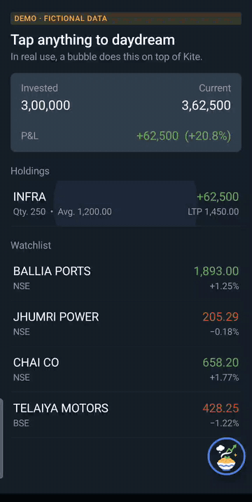
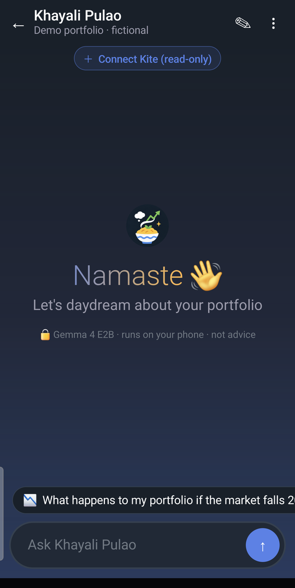
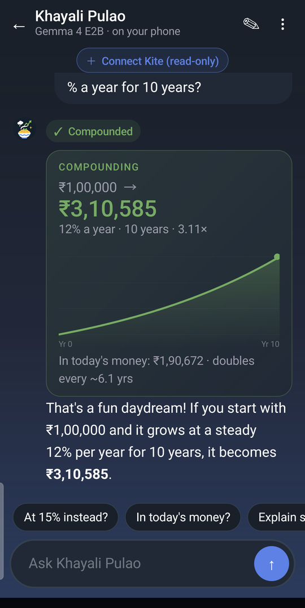
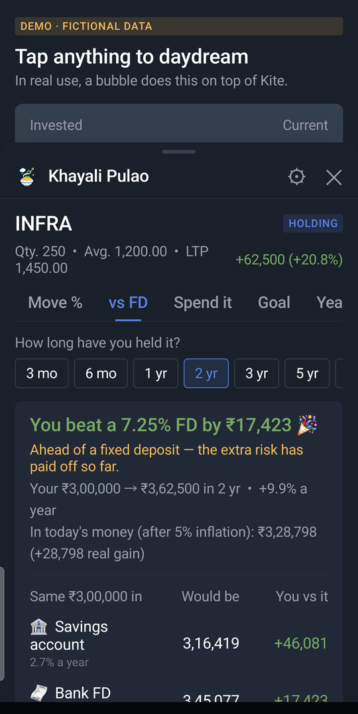
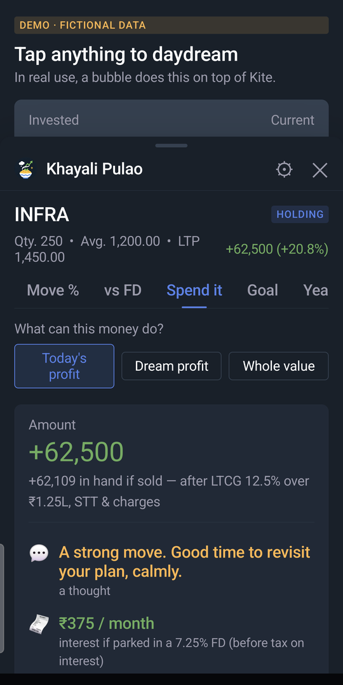
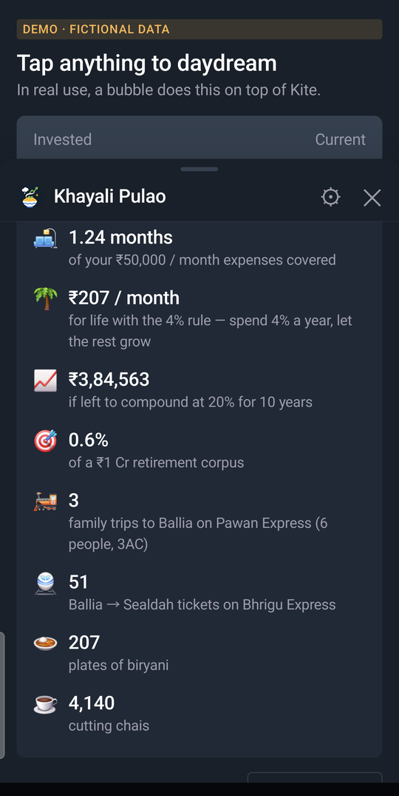
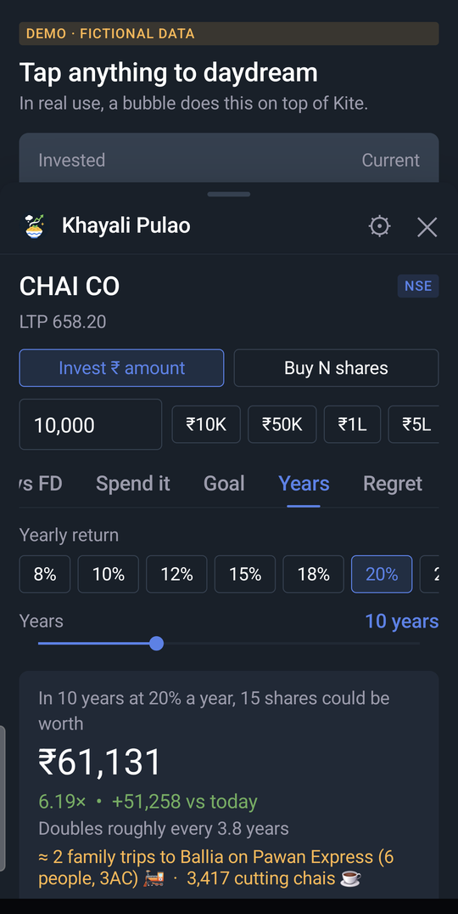
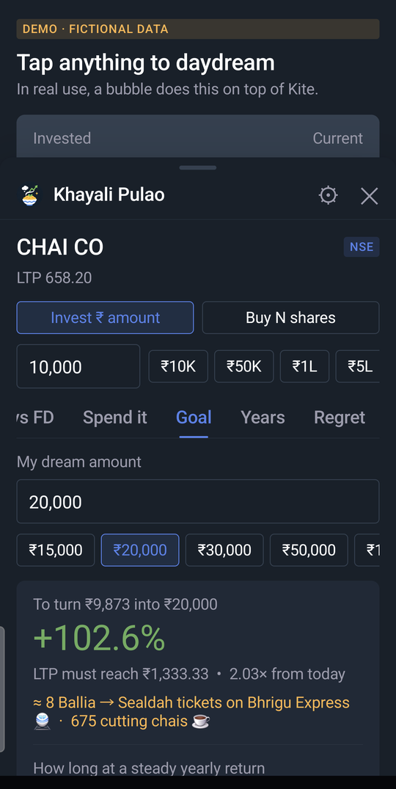
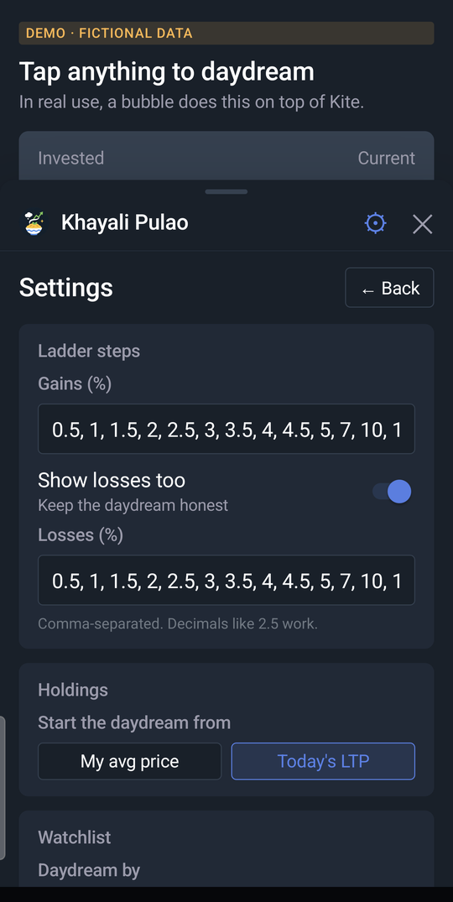

<p align="center">
  
</p>

<h1 align="center">Khayali Pulao</h1>

<p align="center">
  <b>A daydream calculator that floats on top of Zerodha Kite.</b><br>
  Tap a holding and see what it would be worth at +0.5%, +5%, +15%, 2× — whether you beat an FD — and what the profit actually buys, in hand after tax.
</p>

<p align="center">
  <a href="https://github.com/iprajax/khayali-pulao/actions/workflows/ci.yml"></a>
  
  
  
  <a href="LICENSE"></a>
</p>

<p align="center">
  <a href="https://iprajax.github.io/khayali-pulao/">Website</a> ·
  <a href="https://github.com/iprajax/khayali-pulao/releases">Download APK</a> ·
  <a href="https://iprajax.github.io/khayali-pulao/#try">Try it in your browser</a> ·
  <a href="PRIVACY.md">Privacy</a> ·
  <a href="SECURITY.md">Security</a>
</p>

---

> **ख़याली पुलाव (khayali pulao)** — literally *"imaginary pulao"*: rice you cook only in your head.
> It's how Hindi says *daydreaming* or *building castles in the air*. Every investor does it — this app just does the maths properly.

<p align="center">
  
  <br><sub>Recorded in the in-app <b>Demo</b> — every name and number is fictional.</sub>
</p>

## ✨ Ask Khayali Pulao — on-device AI chat

<table>
  <tr>
    <td></td>
    <td></td>
  </tr>
</table>

- **Gemma 4 E2B runs on your phone** (Google LiteRT-LM, GPU with CPU fallback). Downloaded once from Hugging Face (2.6 GB, SHA-256 verified, resumable, Wi-Fi option); then chat works offline.
- **Tool calling over every calculator** — the model never does maths itself. Each answer comes with a **visual result card** drawn from the tool's exact numbers: growth curve, FD comparison bars, goal ring, tax breakdown, before/after bars, holdings.
- **Number guard** — any ₹ figure the model writes that doesn't match a tool result is removed, so you never see an invented number.
- Understands **"10 lakh", "1.5 crore", "50k"**. Changes settings ("set my FD rate to 7%") and opens screens.
- In the app and in the bubble sheet over Kite (✨), where it already knows the stock you tapped.
- **/commands** — `/holdings` `/pnl` `/positions` `/margins` `/orders` `/mf` (instant cards from Kite, no AI needed), `/fd 3` `/goal 50 lakh` `/grow 1 lakh 12% 10y` `/move -20` `/tax` (exact calculators, no AI needed), `/price` `/events` `/results` `/news` `/web` (opt-in web, with sources), `/remember` `/memory` `/forget`, `/clear` `/help`.
- **@mentions** — type `@` to pick one of your Kite holdings: *"What if @INFY goes up 20%?"*
- **Share any answer** as an image (card + text, branded) to WhatsApp, X, Instagram… — with a warning before sharing real amounts.
- Gemini-style motion: flowing gradient greeting, thinking shimmer, word-by-word fade-in, glowing input, follow-up pills.

### 🔗 Connect Kite (optional, read-only)

Tap **Connect Kite** in the chat to let it read your real holdings, positions, margins and orders through **Zerodha's official [Kite MCP](https://github.com/zerodha/kite-mcp-server)** (`mcp.kite.trade`), using standard MCP OAuth 2.1 (PKCE + a one-time loopback redirect on the phone). You log in on Zerodha's own page in your browser — if you're already logged in to Kite in Chrome it's usually a one-tap "Authorize". The app **only allows read tools**: every order/GTT tool is blocked in code (and tested), on top of Zerodha's hosted server excluding them. Your Kite data comes from Zerodha to your phone and is used only by the on-device model.

<!-- terminal-commands -->
## 📟 Market terminal — 72 commands

Chart cards built from public, no-login data: NSE's own feeds and exchange filings, public price feeds, World Bank and mfapi.in open data. Web access is opt-in; the calculators and portfolio views marked *works offline* never touch the network. Your holdings are matched on the phone and never sent. Type `/` in the chat to browse, or just ask — short questions like "show me the heatmap" run the matching card directly, and the AI can call any of them.

**Market** (15)

| Command | What you get |
|---|---|
| `/report` | Market report: indices, breadth, sectors, top gainers and losers, FII/DII flows, your stocks — one card |
| `/sectormovers` | Sector-wise top gainers and losers: each sector's move with its best and worst stocks |
| `/preopen` | Pre-open session: indicative opening prices, gap-ups and gap-downs in F&O stocks |
| `/heatmap NIFTY BANK` | Index heatmap: every constituent sized by traded value, coloured by today's move |
| `/indices sectoral` | NSE indices ranked by today's move (broad, sectoral, thematic, strategy), with P/E and 52-week position |
| `/sectors` | Sector indices ranked by today's move, with 30-day and 1-year change (/sectors 30d or 1y to rank by those) |
| `/movers fno` | Top gainers and losers today — NIFTY 50 by default, or bank, next50, fno, all |
| `/breadth` | Market breadth: how many NSE stocks are up, down and unchanged today, and the advance/decline ratio |
| `/active` | Most active securities today: by traded value (₹ crore) and by number of shares |
| `/status` | Is the market open? Each NSE segment's state, plus the previous session's turnover by segment |
| `/highs` | Stocks that set a new 52-week high or low today, with the count on each side |
| `/bands` | Stocks that hit their upper or lower price band (circuit limit) today |
| `/volume` | Unusual volume: stocks trading at several times their 1-week average volume today |
| `/fiidii` | FII/FPI and DII buying, selling and net flow in the cash market for the latest day |
| `/deals INFY` | Bulk and block deals: who bought or sold, quantity and price — all, or for one stock |

**Stock** (19)

| Command | What you get |
|---|---|
| `/flow INFY` | Quarterly results as a money-flow (Sankey): income → costs → tax → profit, with a 5-quarter trend |
| `/insider INFY` | Insider trades disclosed for one company: who bought or sold, how much and when |
| `/announcements INFY` | A company's latest exchange announcements: subject, date and a one-line gist |
| `/filings INFY` | Company snapshot: latest announcements, corporate actions, board meetings and results filed |
| `/quote INFY` | Full quote: price, day and 52-week range position, VWAP, volume, delivery, P/E vs sector |
| `/shareholding INFY` | Who owns the company: promoter, public and employee-trust holding by quarter (streamgraph) |
| `/mindmap INFY` | Mind map of one company: price, latest results, ownership, events and sector peers |
| `/scorecard INFY` | Radar of one stock's year: return, volatility, drawdown, trend and dividend yield, each 0–100 |
| `/peers IT` | Sector peers side by side: every stock of a sector index with price and today's change |
| `/history INFY` | NSE daily history for a month: open-high-low-close candles, VWAP, volume and turnover |
| `/ta INFY` | Price with 20/50/200-day moving averages and Bollinger bands |
| `/rsi INFY` | 14-day RSI with the 30/70 zones and what the latest reading means in plain words |
| `/macd INFY` | MACD (12, 26, 9): MACD line, signal line and histogram, with the latest crossover |
| `/drawdown INFY` | Underwater chart: fall from the running peak over 5 years, the worst drawdown and its recovery time |
| `/returns INFY` | Returns over 1 week to 5 years, with CAGR, against the Nifty 50 over the same periods |
| `/seasonality INFY` | Month by year grid of monthly returns as a heat matrix, with the average for each month |
| `/compare INFY TCS 1y` | Two to four stocks or indices rebased to 100 over a period (1mo 3mo 6mo 1y 2y 5y) |
| `/levels INFY` | Support and resistance: classic pivot levels from the last session, plus the 52-week high and low |
| `/volatility INFY` | Rolling 30-day annualised volatility over a year, and the current reading against its own range |

**Portfolio** (10)

| Command | What you get |
|---|---|
| `/watch` | Your watch list: stocks you've looked at in chat plus your holdings, with sparklines |
| `/xray` | Portfolio X-ray: allocation sunburst, largest weights and how concentrated your holdings are · works offline |
| `/pnlflow` | Portfolio money-flow (Sankey): what you invested in each stock and what it became — gain or loss · works offline |
| `/risk` | Portfolio risk: volatility, beta vs Nifty 50 and 1-day 95% value-at-risk in rupees |
| `/correlation` | How your holdings move together: correlation matrix of daily returns (8 largest holdings) |
| `/riskreturn` | Risk vs return scatter: each holding's 1-year volatility, return and weight |
| `/stress` | Stress test: portfolio value if the Nifty fell 5, 10, 20 or 30%, using each holding's beta |
| `/income` | Dividend income: last 12 months' dividends per share × your quantity, with yield |
| `/rebalance` | Equal-weight comparison: how many rupees over or under an equal share each holding is · works offline |
| `/foliomap` | Portfolio mind map: total value at the centre, one branch per holding with weight and P&L · works offline |

**Derivatives** (9)

| Command | What you get |
|---|---|
| `/oispurts` | Open-interest spurts: derivatives underlyings with the biggest change in open interest |
| `/optionchain NIFTY` | Option chain: open interest by strike, calls vs puts, around spot for the nearest expiry |
| `/pcr NIFTY` | Put-call ratio by open interest and by volume for the nearest expiries, and what it means |
| `/maxpain NIFTY` | Max-pain strike for the nearest expiry, worked out from open interest, with the pain curve |
| `/ivsmile NIFTY` | Implied volatility by strike for calls and puts (the volatility smile) for the nearest expiry |
| `/straddle NIFTY` | At-the-money straddle price and the move, in points and %, that options price in by expiry |
| `/oichange NIFTY` | Today's biggest additions and unwinding of open interest by strike, calls and puts |
| `/expiries NIFTY` | Upcoming option expiry dates for an index or stock, with days to go |
| `/vix` | India VIX: level, position in its 1-year range and the daily move it roughly implies |

**Funds & planning** (6)

| Command | What you get |
|---|---|
| `/etfs gold` | Exchange-traded funds: the most traded, with price and day change — add a word to filter |
| `/sgb` | Sovereign gold bonds on NSE: last traded price against issue price, most traded first |
| `/gold` | Gold in rupees per 10 grams, derived from the dollar price and USD/INR, with a 1-year chart |
| `/fund parag flexi` | A mutual fund by name: latest NAV, 1-month to 5-year returns and the NAV chart |
| `/fundcompare parag flexi vs nifty 50 index` | Two mutual funds side by side, both rebased to 100 over three years |
| `/sipreal parag flexi 10000 5y` | What a monthly SIP in a fund would be worth today, from its actual NAV history, with XIRR |

**Global & macro** (7)

| Command | What you get |
|---|---|
| `/global` | World indices at a glance: last level, day change and a 1-month sparkline for ten markets |
| `/fx` | Rupee against USD, EUR, GBP, JPY, AED and SGD with day and 1-year change |
| `/commodities` | Gold, silver, crude oil, natural gas and copper in dollars with day and 1-month change |
| `/crypto` | Bitcoin and ether in dollars and rupees with day change and a 1-month line |
| `/inflation` | India CPI inflation by year, the latest value and the 10-year average |
| `/gdp` | India real GDP growth by year, the latest value and the 10-year average |
| `/yields` | US 10-year yield, 13-week bill yield and the dollar index with 1-year lines |

**Tools** (6)

| Command | What you get |
|---|---|
| `/sip 10000 12% 15y` | SIP calculator: monthly amount, yearly return and years → corpus, invested and growth · works offline |
| `/stepup 10000 10% 12% 15y` | Step-up SIP: a SIP raised by X% every year, compared with keeping it flat · works offline |
| `/swp 1 crore 80000 8%` | Systematic withdrawal: how long a corpus lasts under a fixed monthly withdrawal · works offline |
| `/emi 50 lakh 8.5% 20y` | Loan EMI: amount, rate and years → EMI, total interest and the yearly principal-interest split · works offline |
| `/retire 50000 25y 25y 6% 12% 8%` | Retirement corpus: expenses today, years to and in retirement → corpus and the SIP needed · works offline |
| `/lumpsum 12 lakh 12% 10y` | Lump sum vs SIP: the same total invested at once or monthly, at a given return · works offline |
<!-- /terminal-commands -->

## What's new in 0.8

- **A chat that doesn't get stuck** — one explicit state machine behind typing, pills, /commands, retries and reconnects. Came back next morning and `/holdings` failed? Zerodha signs you out daily and Android may have unloaded the model; the app now detects both, offers **Reconnect**, keeps your command and runs it when you're back.
- **Commands need no model** — `/holdings` `/chart` `/fd` `/goal` `/grow` `/move` `/tax` are run by the app: exact and instant, even before the 2.6 GB model is downloaded.
- **Web, with sources (opt-in)** — `/price INFY`, `/events INFY`, `/results INFY`, `/news INFY`, `/web …`, and the model can look things up too. DuckDuckGo search + a public quote feed. Answers cite numbered sources; figures that aren't in a source are removed. Only topic words are sent — amounts, quantities and identifiers are stripped from every query.
- **Market calendar & IPOs** — `/calendar` (results, dividends, splits, bonus, buybacks, AGMs, IPOs and holidays for the week, your holdings starred), `/ipo` and `/gmp NAME` (grey-market premium trend and implied listing price, clearly labelled unofficial).
- **Market terminal — 72 commands** — `/report` (the whole market on one card), `/preopen`, `/sectormovers`, `/heatmap`, `/flow INFY` (results as a Sankey from the XBRL filing), `/mindmap INFY`, `/shareholding INFY` (streamgraph), option chain, technicals, portfolio X-ray, global markets, mutual funds and planners — [full list](#-market-terminal--72-commands).
- **Memory that learns, on your phone** — a small playbook of notes (your goals and preferences, plus lessons from the chat's own mistakes) that is reflected on and curated after each answer, in the style of [agentic context engineering](https://arxiv.org/abs/2510.04618). Read, delete or erase it with `/memory`.
- **Readable on a phone** — market cards use native, colour-coded blocks: a scrolling ticker tape, sparkline rows with green/red change pills, sector bars, stat tiles and a breadth bar. `/report` puts indices, breadth, sectors, top gainers and losers, FII/DII flows and your stocks on one card with a written read-out; `/preopen`, `/sectormovers` and `/watch` (stocks you've looked at in chat) work the same way.
- **Charts with labelled axes** — and new ones: candlesticks with volume, what-if curve, goal paths, tax waterfall, allocation donut, company-events calendar.
- **The thread survives** — saved on the phone and restored with its cards when you return.
- **20 audited fixes** across the overlay, sheet and home screen — see the [changelog](CHANGELOG.md).

## What's new in 0.7

- **Interactive D3 answers** — every result is a native card with an animated chart (holdings treemap + P&L, price history with scrubbing, compounding curve vs inflation, FD/PPF/gold/Nifty bars, goal ring, tax split, margins donut, orders timeline). Same renderer runs live on the [website](https://iprajax.github.io/khayali-pulao/#visuals). d3 is bundled; the chart WebView blocks all network.
- **Personas** — 📊 Analyst · 🧭 Financial planner · 🔎 Research. Same exact tools; different focus. Educational only — never buy/sell/hold calls; not a SEBI-registered adviser.
- **Kite MCP, all read methods** — holdings, positions, margins, profile, mutual funds, orders/trades, live price (falls back to last close when the market is shut), price history. Read-only enforced per *(tool, mode)*.
- **Context pills** — starters built from your live holdings (biggest, best, worst, concentration) and follow-ups from the last result; exact re-runs like "at 15% a year".
- **Exact numbers** — percentages you type are pinned to the tool call; when a calculator ran, the reply shows its exact summary and only number-free insight from the model.
- **Response details** — tap ⏱ for total time, time to first word, tokens/s, GPU/CPU and every tool step.
- **New home** — bento dashboard + left drawer; settings on their own screen; comparison rates refreshed (Nov 2026).

## What it does

| | |
|---|---|
| **Move %** | What if it moves +0.5% … +5% … +15% … 2×? A ladder (0.5% steps to 5%, then 7, 10, 12, 15, 20…), slider, ± steps that walk your own levels, and *target price → %*. From your average price or today's LTP. |
| **vs FD** | Did you actually beat a bank FD? Your real yearly return (CAGR) and inflation-adjusted gain vs savings, FD, PPF, gold, Nifty and inflation. Every rate is yours to set. |
| **Spend it** | Profit *in hand* after LTCG (₹1.25 L exemption) or STCG, STT and DP charges — then what it means: FD interest per month, months of your expenses covered, 4%-rule income, 10-year compounding. |
| **Goal** | "I want ₹2 Cr." How much it must rise, the LTP needed, and roughly how many years at 8–25% a year. |
| **Years** | Compounding: today's value after 1–30 years at the return you pick. |
| **Regret** | *Agar tab liya hota* — what if you'd bought cheaper? |
| **Whole portfolio** | Tap Kite's Invested / Current card to daydream everything at once. |
| **Pulao maths** | Gains in desi units — cutting chais ☕, Ballia → Sealdah tickets on Bhrigu Express 🚆, family trips to Ballia on Pawan Express 🚂, a bhains for the village 🐃, a plot in Ballia 🌾 or Jhumri Telaiya 🏡 — plus your own dream unit. |
| **Tone** | *Serious* (numbers only) · *Light* (calm one-liners, default) · *Masala* (FD wale uncle has opinions). |

## Screenshots

<table>
  <tr>
    <td></td>
    <td></td>
    <td></td>
    <td></td>
  </tr>
  <tr>
    <td align="center"><sub>Move %</sub></td><td align="center"><sub>vs FD</sub></td>
    <td align="center"><sub>Spend it — in hand</sub></td><td align="center"><sub>…and what it buys</sub></td>
  </tr>
  <tr>
    <td></td>
    <td></td>
    <td></td>
    <td></td>
  </tr>
  <tr>
    <td align="center"><sub>Goal</sub></td><td align="center"><sub>Years</sub></td>
    <td align="center"><sub>Watchlist stock</sub></td><td align="center"><sub>Everything is configurable</sub></td>
  </tr>
</table>

<sub>All screenshots come from the in-app Demo with fictional data. In real use the same sheet opens on top of Kite.</sub>

## 🔒 Your portfolio never leaves your phone

- **Three optional uses of the internet, each off until you choose it.** The one-time AI model download from Hugging Face (SHA-256 checked); Zerodha's official read-only Kite MCP, if you tap Connect Kite; and web lookups, if you allow Web. A unit test fails the build if any other host or networking code appears.
- **Web lookups send topic words only.** Search words go to DuckDuckGo, price lookups to Yahoo Finance. Amounts, quantities and identifiers are stripped from every query in code; holdings are never sent. No cookies, a generic user agent, and nothing but the results page may load.
- **On-device AI.** The chat runs Gemma 4 on your phone — your questions and Kite's numbers are never sent to a cloud AI.
- **Reads, never trades.** It reads the numbers Kite already shows, only while Kite is open. While the bubble is on, your taps can't reach Kite's Buy/Sell.
- **What is stored, and where.** Your settings, the hold periods you type, the current chat thread and the chat's memory notes — private files on the phone, excluded from cloud backup and phone-to-phone transfer. New chat clears the thread; Memory → Erase clears the notes.
- **No login, analytics, ads or trackers.** No third-party SDKs at all.

Details: [PRIVACY.md](PRIVACY.md) · [SECURITY.md](SECURITY.md)

## Install

1. Download `khayali-pulao-<version>.apk` from [Releases](https://github.com/iprajax/khayali-pulao/releases) and install it (allow *Install unknown apps* for your browser/files app).
2. Open **Khayali Pulao → Turn it on** → Accessibility → Installed apps → *Khayali Pulao* → On.
   *Android 13+: if it's greyed out, go to Settings → Apps → Khayali Pulao → ⋮ → Allow restricted settings.*
3. Open Kite. Tap the 🍚 bubble (blue ring = on), then tap any holding, watchlist stock or the Invested card.

No Kite? Tap **Try the demo** on the home screen.

## How it works

```
 Kite (unchanged)                    Khayali Pulao (on-device)
 ───────────────                     ──────────────────────────
 Holdings row  ── accessibility ──►  KiteParser  ──►  Projector / Dreams / Costs  ──►  DreamSheet
 "INFRA, quantity 250, average       (regex on the       (pure Kotlin maths,            (Kite-styled
  price 1,200.00, … last traded       row's text)          unit-tested)                  bottom sheet)
  price 1,450.00"
```

Kite exposes each row to Android accessibility as plain text. Khayali Pulao parses that text, does the maths locally, and draws its own sheet as an accessibility overlay. No screenshots, no OCR, no network.

## Build from source

```bash
git clone https://github.com/iprajax/khayali-pulao.git && cd khayali-pulao
./gradlew testDebugUnitTest     # maths, parser, tax/charges and on-device-only guards
./gradlew assembleDebug         # app/build/outputs/apk/debug/app-debug.apk
```

Requires JDK 17 and Android SDK 35. Release signing reads `KP_KEYSTORE`, `KP_KEYSTORE_PASSWORD`, `KP_KEY_ALIAS`, `KP_KEY_PASSWORD` from the environment — keys never live in the repo.

## FAQ

**Is this made by Zerodha?** No. It's an independent, open-source side project. It doesn't use any Zerodha API, login or servers — it only reads what the Kite app already shows on your own screen.

**Why an Accessibility service?** It's the only on-device way to read another app's on-screen text without screenshots or network access. The service is scoped to Kite, read-only, and can't place orders.

**Which AI model, and how big?** Gemma 4 E2B (Apache-2.0) via Google's LiteRT-LM. 2.6 GB download, ~0.8 GB RAM on GPU. You can delete it from the chat menu.

**Can the AI place trades?** No. It has no trading tools, and the Kite connection allows read-only calls only — both are enforced in code and covered by tests.

**Is it on the Play Store?** Not currently — Google Play restricts Accessibility API use to accessibility tools, so it's distributed as an APK on GitHub.

**Are the tax and charges exact?** No — they're estimates (12.5% LTCG above ₹1.25 L, 20% STCG, 0.1% STT, ₹15.34 DP charge, small exchange/SEBI/GST). Gold and Nifty returns are assumed long-run averages you can change.

## Disclaimer

Khayali Pulao is a **daydream**, not investment, tax or financial advice. Projections are hypothetical and markets can go down as well as up. "Zerodha" and "Kite" are trademarks of Zerodha Broking Ltd., used here only to describe compatibility; this project is not affiliated with or endorsed by Zerodha.

## Credits

App icon and illustrations generated with ChatGPT image generation, then edited. Colours follow Kite's dark theme so the overlay feels at home.

## License

[MIT](LICENSE)
